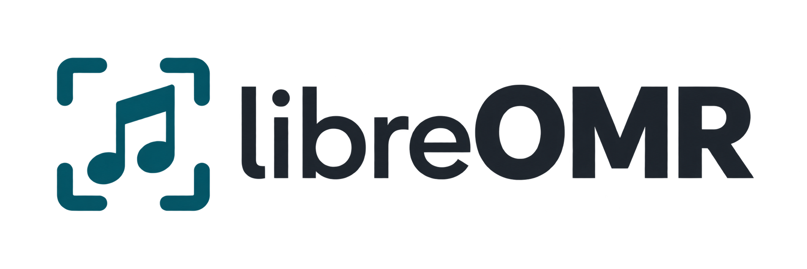
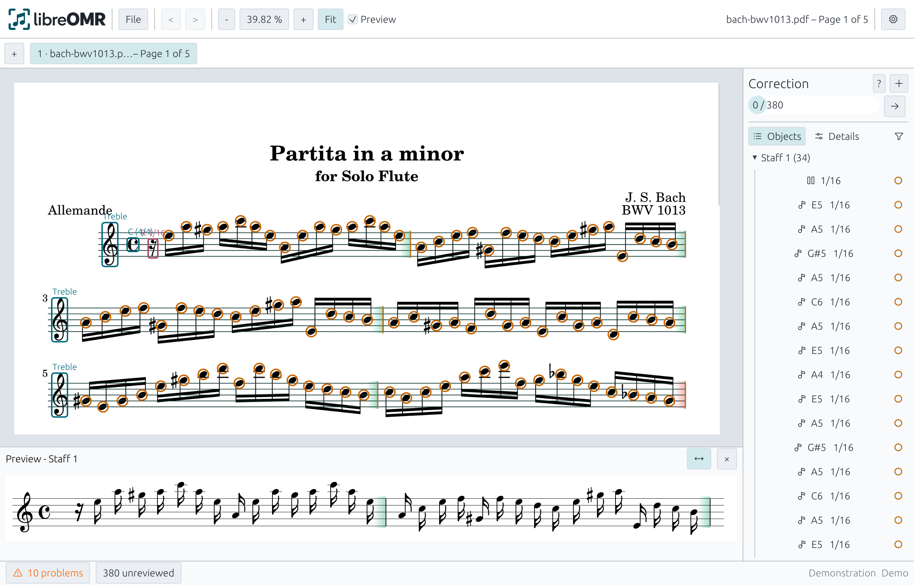
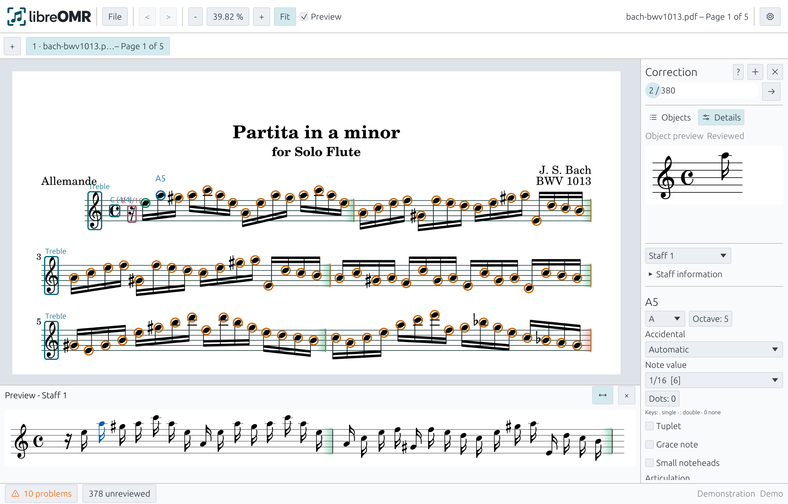
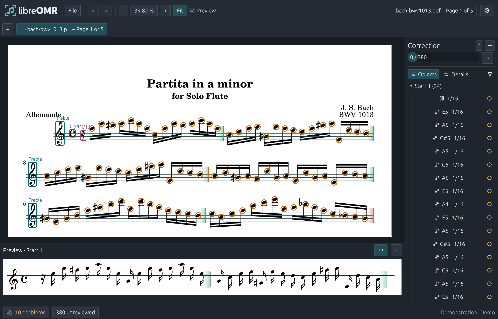
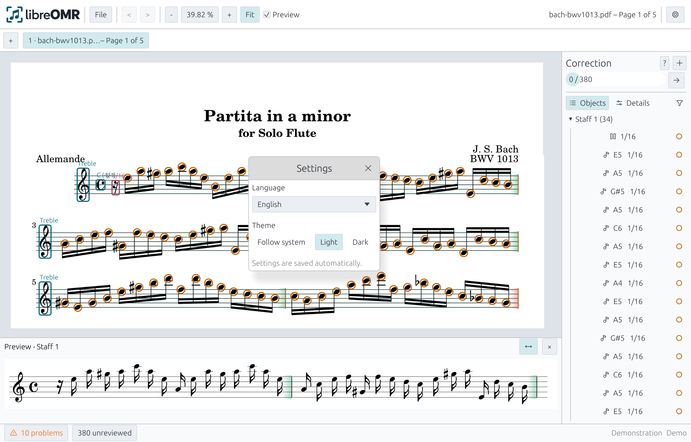

# libreOMR

<p>
  
</p>

libreOMR is a desktop application for optical music recognition on Linux,
Windows and macOS. It turns score images into editable recognition proposals:
open a score, review notes and symbols, correct mistakes and export the result
as MusicXML. All files are processed locally.

**This project is an early prototype.** Recognition uses heuristics and symbol
templates. Results require musical review and correction.

## Features

- Import PDF, PNG, JPEG, TIFF and BMP, including multipage PDFs and TIFFs.
- Recognize and edit notes, rests, clefs, accidentals and time signatures.
- Review and add articulations, dynamics, slurs, ties and repeat marks.
- Compare the original image, recognized objects and notation preview directly.
- Undo corrections and save projects with embedded score images.
- Export all pages together as MusicXML 4.0 for further work in tools such as MuseScore.
- Use English or German, with the system language selected by default.
- Choose light, dark or system appearance in Settings.

## Screenshots

The screenshots show the first page of Bach's **Partita in A minor for solo
flute, BWV 1013**, using Jacob Shapiro's public-domain typesetting from the
[Mutopia Project](https://www.mutopiaproject.org/cgibin/piece-info.cgi?id=1528).
The [sample PDF](examples/public-domain/bach-bwv1013.pdf) is included for trying
the app; its [source and rights](examples/public-domain/README.md) are documented.
The proposals shown are not a finished, corrected transcription.

**Score image, recognized objects and preview**



**Review and correct individual notes**



**Dark mode**



**Language and appearance settings**



## Install and run

### Download a package

Published versions are available from
[GitHub Releases](https://github.com/kabakakao/libreOMR/releases).
The [0.1.2 release notes](docs/release-notes/0.1.2.md) describe language selection,
saved appearance settings and starting Windows without a console window.

| Platform | Package |
| --- | --- |
| Windows x86_64 | ZIP containing `libreomr.exe` |
| Windows ARM64 | ZIP containing a native ARM64 `libreomr.exe` |
| Linux x86_64 | TAR.GZ containing `libreomr` |
| macOS Apple Silicon | ZIP containing `libreOMR.app` |

Extract the entire archive for your platform, then start the application.
On macOS, copy `libreOMR.app` to Applications. The app is not yet signed or
notarized, so macOS may require approval in **System Settings > Privacy & Security**.
Intel Macs are not supported.

The Windows executable starts without a console window and embeds icons at
multiple resolutions for Explorer and shortcuts. The macOS bundle includes
Finder and Dock icons with Retina resolutions.

Linux requires a graphical X11 or Wayland session and the system libraries
for XKB, Wayland and EGL. File dialogs use `xdg-desktop-portal` with a backend
appropriate for your desktop environment.

The Linux archive also includes a desktop entry and application-menu icons.
Extract it to a permanent location, then run the following from that directory
to install the menu entry for the current user without administrator privileges
(Python 3 required):

```sh
python3 install-desktop.py
```

The entry starts the app from this directory. Run the command again if you move
the directory. Files are installed in `applications` and `icons/hicolor` under
`${XDG_DATA_HOME:-~/.local/share}`.

On Windows, the build includes the **wgpu renderer using Direct3D 12**. No
additional OpenGL driver or separately downloaded OpenGL DLL is required.
Windows 10/11 and working Direct3D 12 support in Windows and the graphics driver
are required.

Startup and runtime errors appear in a native error dialog, even if the main
window could not open. The dialog includes technical details and the error-report
path. On Windows this is normally `%LOCALAPPDATA%\libreOMR\error.log`, falling
back to `%TEMP%\libreOMR\error.log`. Rust panics are also reported and logged
with a stack trace. Attach the report when filing an issue.

For graphics problems, first update Windows and the graphics driver from your
device manufacturer; in virtual machines, also check the guest tools. If a
Vulkan driver is available, you can try this alternative to Direct3D 12 in PowerShell:

```powershell
$env:WGPU_BACKEND = 'vulkan'
.\libreomr.exe
```

This setting applies to the current PowerShell session. Clear it with
`Remove-Item Env:WGPU_BACKEND`.

Each release includes the public Bach example, license notices and SHA-256
checksums. You can also build libreOMR from source.

### Build from source

Install a [Rust toolchain](https://rustup.rs/) version **1.92** or newer.
Run the following commands from the project root.

macOS also requires Xcode Command Line Tools. Windows requires the MSVC build
tools and Windows SDK. On Debian/Ubuntu, install the system dependencies with:

```sh
sudo apt-get install build-essential pkg-config libxkbcommon-dev libwayland-dev libegl1-mesa-dev
```

Build and run the application:

```sh
cargo run --release --locked
```

Or build without running:

```sh
cargo build --release --locked
```

The executable is `target/release/libreomr`, or `target/release/libreomr.exe`
on Windows. To create and open a local macOS bundle on an Apple Silicon Mac:

```sh
sh scripts/build-macos-app.sh
open target/release/libreOMR.app
```

## Usage

### 1. Open a score

The app starts with a generated score example. Choose **File > Open image**
and select one or more files. The included
[Bach example](examples/public-domain/bach-bwv1013.pdf) is a useful starting point.
PDF and multipage TIFF files get a separate tab for each page. Pages are analyzed
sequentially in the background.

Use **File > Add pages**, or the **+** beside the tabs, to add more pages.
Drag tabs to reorder them; this also determines export order. **Fit**, the zoom
buttons and the percentage control help you navigate the score image.

### 2. Review and correct recognition

Select an object in the scan, object list or preview. The **Correction** panel
on the right lets you edit its properties, such as pitch, accidental, note value,
dots or articulation. The object preview shows the selected symbol; the notation
preview below shows the current staff.

Move or delete incorrect objects. Use the score image's context menu to insert
missing notes, rests and other symbols. Clef, key signature and time signature
are available under **Staff information**. You can undo and redo changes.

Confirm a reviewed object with the circle in the object list. **F6** jumps to
the next unreviewed object. Confirmation records your review; the rest of the
score still needs checking.

### 3. Check measures and export notices

Colored measure regions indicate whether the sum of recognized note values
matches the time signature. Click **Export check** to open the list of problems
and unreviewed objects. Select an entry to navigate to its location. Correct
missing information and inconsistent durations before exporting. Pickup measures
may intentionally be incomplete.

### 4. Save a project

**File > Save** writes a `.libreomr.json` file containing all pages as embedded
images, their order and your corrections. Resume with **File > Open project**;
the original image files are no longer needed.

**Recognize again** replaces the active page's proposals and corrections. Save
the current state first if you need to keep it.

### 5. Export MusicXML

**File > Export MusicXML** writes all pages in tab order to a `.musicxml` file.
Open it in a notation program such as MuseScore for further editing. Saving and
exporting become available once every page has been analyzed successfully.

Export uses the current state, including unreviewed objects. Read the notices
after export and check the result in your notation program. Also save the
libreOMR project if you want to resume corrections later.

### 6. Choose language and appearance

Open **Settings** with the gear button at the top right. **Language** offers
**System default**, **English** and **Deutsch**. System default uses German for
German system locales, including Germany, Austria and Switzerland, and English
for other locales. **Theme** offers **Follow system**, **Light** and **Dark**.
Both preferences default to the system and take effect immediately. Choices
are saved automatically for the current user and restored on the next launch.

Settings are separate from score projects and stored in:

| Platform | Settings file |
| --- | --- |
| Windows | `%APPDATA%\libreOMR\settings.json` |
| macOS | `~/Library/Application Support/libreOMR/settings.json` |
| Linux | `${XDG_CONFIG_HOME:-~/.config}/libreOMR/settings.json` |

Native file dialogs and operating-system buttons follow the operating system's
own language. See [Localization](docs/localization.md) for the language-file format
and instructions for adding translations.

## Keyboard shortcuts

Use **Cmd** on macOS and **Ctrl** on Linux and Windows.

| Shortcut | Action |
| --- | --- |
| Cmd/Ctrl + O | Open score images |
| Cmd/Ctrl + Shift + O | Open project |
| Cmd/Ctrl + S | Save project |
| Cmd/Ctrl + Z | Undo |
| Cmd/Ctrl + Shift + Z | Redo |
| F6 | Next unreviewed object |
| Delete / Backspace | Delete selected object |
| Escape | Close context menu or clear selection |

For selected notes and rests, **1, 2, 4, 8** set whole, half, quarter and eighth
values; **6, 3, 9** set 1/16, 1/32 and 1/64. **.** adds a single dot, **:** adds
two dots and **0** removes dots. For notes, **#**, **b** and **=** set a sharp,
flat or natural. The **?** in the Correction panel shows editing shortcuts.

## Current limitations

libreOMR is primarily suitable for trying the workflow on clear, printed
single-part scores. Skewed or damaged scans, dense beaming, unfamiliar fonts
and overlapping symbols can cause missing or incorrect proposals.

Export treats staves as **one continuous part**. Full reconstruction of
polyphonic piano or orchestral scores, automatic instrument assignment and
transposition are not implemented. The preview shows the edited recognition
state; beaming and page layout are not reconstructed faithfully. Error-free
transcription of arbitrary scores is not currently achieved.

## License

libreOMR is licensed under the **GNU General Public License v3.0 or later**
(`GPL-3.0-or-later`); see [LICENSE](LICENSE) for the full text. Modified versions
must also comply with the GPL when distributed.

Bundled components retain their own licenses. The Bravura font uses the
[SIL Open Font License 1.1](assets/Bravura-LICENSE.txt), and the
[Bach example](examples/public-domain/README.md) is public domain.
